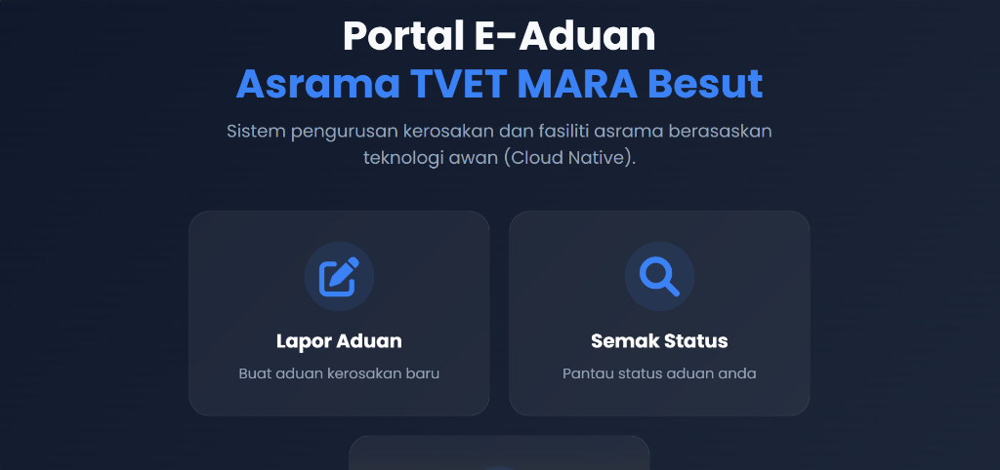

# Sistem Aduan Asrama IKM Besut

<div align="center">
  

  <p><strong>From a reported hostel problem to a visible status.</strong></p>
  <p>Sistem pengurusan aduan fasiliti & kerosakan asrama berasaskan teknologi awan (Cloud Native Serverless), dibangunkan untuk pelajar dan warden Institut Kemahiran MARA (IKM) Besut.</p>

  <p>
    <a href="https://sistemaduanasrama.syahmiaof.my"></a>
    <a href="https://github.com/syahmiaof/sistem-aduan-asrama-ikm"></a>
    <a href="LICENSE"></a>
    <a href="https://github.com/syahmiaof/sistem-aduan-asrama-ikm/actions"></a>
    <a href="https://syahmiaof.my"></a>
  </p>

  <br />
</div>

---

## 🌟 Sorotan & Ciri Utama

* 📱 **PWA Ready (Progressive Web App):** Boleh dipasang terus ke skrin utama peranti Android dan iOS tanpa muat turun stor aplikasi, menyokong pengalaman seakan aplikasi natif.
* 🤖 **Notifikasi Telegram Segera:** Setiap laporan baharu yang dihantar akan serta-merta memaklumkan warden bertugas melalui Telegram Bot API.
* 📊 **Dashboard Warden & Analitik:** Paparan papan pemuka interaktif dengan carta statistik kerosakan mengikut kategori dan blok asrama dikuasakan oleh Chart.js.
* 🔍 **Semakan Status Telus:** Pelajar boleh menyemak status terkini aduan mereka (Baru, Dalam Tindakan, Selesai) pada bila-bila masa menggunakan No. Matrik / NDP.
* 🌙 **Antaramuka Moden & Dark Mode:** Reka bentuk mesra pengguna dengan tipografi bersih, pengesahan borang dinamik, dan sokongan mod gelap.

---

## 🏗️ Seni Bina Sistem

```
┌─────────────────┐       ┌──────────────────────┐       ┌────────────────────────┐
│  Pelajar (PWA)  │ ────> │  Cloud Firestore DB  │ <───> │  Admin Dashboard       │
│  Isi Borang     │       │  Penyimpanan Realtime│       │  Warden Urus & Kemas   │
└────────┬────────┘       └──────────────────────┘       │  Kini Status Aduan     │
         │                                               └────────────────────────┘
         │ (Trigger Notifikasi)
         v
┌────────────────────────┐
│  Telegram Bot API      │ ────> Warden Bertugas (Alert serta-merta)
└────────────────────────┘
```

---

## 🛠️ Tech Stack

| Bahagian | Teknologi |
|---|---|
| **Antaramuka (Frontend)** | HTML5 Semantik, CSS3 Moden (Flexbox & Grid), Vanilla JavaScript (ES6+ Modules) |
| **Awan & Pangkalan Data** | Firebase Firestore (Realtime NoSQL), Firebase Hosting, Firebase Auth |
| **Notifikasi Luar** | Telegram Bot API |
| **Visualisasi & Komponen** | Chart.js, SweetAlert2, Font Awesome icons |
| **Automasi & CI** | GitHub Actions (`.github/workflows/ci.yml`) |

---

## ⚙️ Persediaan Tempatan & Konfigurasi Bot Telegram

Bagi membolehkan notifikasi dihantar ke Telegram warden, token disimpan di luar repositori awam:

1. Buat bot baharu melalui [@BotFather](https://t.me/BotFather) dan peroleh token bot.
2. Dapatkan ID bilik perbualan atau kumpulan warden melalui [@userinfobot](https://t.me/userinfobot).
3. Lampirkan konfigurasi selamat dalam persekitaran aplikasi:
   ```javascript
   window.__ENV = {
     TELEGRAM_BOT_TOKEN: "YOUR_BOT_TOKEN",
     TELEGRAM_CHAT_ID: "YOUR_CHAT_ID"
   };
   ```

---

## 🧪 Validasi & Ujian Automasi

Projek ini dilengkapi dengan skrip pengesahan integriti fail dan imbasan keselamatan token:

```bash
# Menjalankan pengesahan integriti aset dan keselamatan rahsia
npm test
```

---

## 📌 Status Projek

Projek pelajar berfungsi sepenuhnya. Repositori awam mendokumentasikan aliran aplikasi dan integrasi awan serverless; ketersediaan operasi institusi dan penghantaran notifikasi bergantung kepada konfigurasi persekitaran warden.

---

## 👤 Pembangun

* **Nama:** [Muhammad Syahmi (syahmiaof)](https://github.com/syahmiaof)
* **Peranan:** Pelajar Diploma Teknologi Komputer (Cloud Computing), Institut Kemahiran MARA (IKM) Besut
* **Portfolio:** [syahmiaof.my](https://syahmiaof.my)
* **Emel:** [syahmiaof123@gmail.com](mailto:syahmiaof123@gmail.com)

---

## 📄 Lesen

Projek ini dilesenkan di bawah [Lesen MIT](LICENSE) — lihat fail [LICENSE](LICENSE) untuk maklumat penuh.

<div align="center">
  <p>© 2026 <strong>Muhammad Syahmi (syahmiaof)</strong>. Hak Cipta Terpelihara.</p>
</div>
